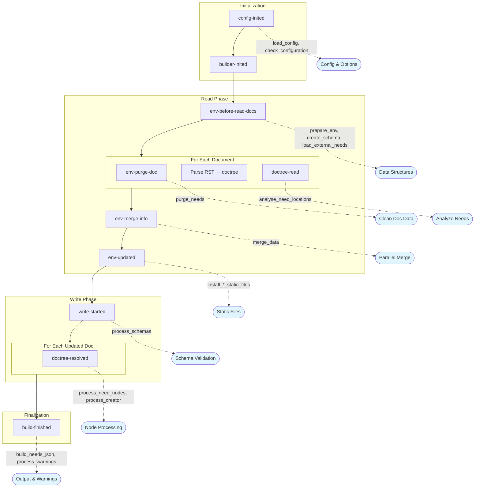

# AGENTS.md — packages/sphinx-needs

This file is an **additive delta** on the repository's root `AGENTS.md`; read that one
first, for the workspace layout, the task names and the commands. Everything here is
specific to the `sphinx-needs` distribution.

**Every path below is relative to this directory**, `packages/sphinx-needs/`, which is
also the working directory of every `poe` task for this package.

## Project Overview

Sphinx-Needs is a Sphinx extension for managing needs/requirements and specifications in documentation. It allows definition, linking, and filtering of class-like need-objects (requirements, specifications, implementations, test cases, etc.).

## Package Structure

```
pyproject.toml         # Distribution metadata, extras and dependency groups
README.rst  LICENSE  AUTHORS

src/sphinx_needs/      # Main source code (importable package)
├── api/               # Public API
├── directives/        # Sphinx directives (need, needtable, needflow, etc.)
├── functions/         # Dynamic functions
├── roles/             # Sphinx roles
├── services/          # External services (GitHub)
├── nodes/             # Docutils nodes
└── ...

tests/                 # Test suite
├── doc_test/          # Test documentation projects
├── benchmarks/        # Performance benchmarks
├── conformance/       # The needflow conformance corpus (shared with ubCode — see the root file)
├── fixtures/          # Data files, among them derive_conformance.toml and field_declaration_conformance.toml: the derived-field and the fields-per-need-type conformance corpora (canonical here; ubCode vendors the first and is to vendor the second)
├── __snapshots__/     # Syrupy snapshot files
└── ...

docs/                  # Documentation source (RST files)
performance/           # Large generated projects for profiling (not collected by pytest)
```

Under `src/` the checkout does not shadow an installed copy, so an import in a test always
resolves to whatever is installed. `--cov=sphinx_needs` is unaffected: it names a module.

## Code Style Guidelines

- **Formatter/Linter**: Ruff (configured in the workspace root `pyproject.toml`)
- **Type Checking**: ty (configured in the workspace root `pyproject.toml`; the `typing` dependency group is the environment)
- **Docstrings**: Use Sphinx-style docstrings (not Google or NumPy style)
- **Function Signatures**: Use `/` and `*` to enforce positional-only and keyword-only arguments where appropriate

### Best Practices

- **Type annotations**: Use strict typing throughout. All function signatures should have complete type annotations. Use `TypedDict` for structured dictionaries, `Protocol` for duck typing.
- **Immutability**: Prefer immutable data structures. Needs are "sealed" (made immutable) after post-processing to prevent accidental modification.
- **Pure functions**: Where possible, write pure functions without side effects. This makes code easier to test and reason about.
- **Avoid global state**: Pass dependencies explicitly rather than relying on global variables.
- **Error handling**: Use specific exception types from `sphinx_needs.errors`. Provide helpful error messages with context.
- **Logging**: Use `sphinx_needs.logging.get_logger(__name__)` for logging. Use `log_warning()` for user-facing warnings.

### Docstrings

The Sphinx-style docstring format should be used throughout the codebase.
Types are not required in docstrings as they should be handled by type hints.

Example:

```python
def process_need(
    need_id: str,
    /,
    *,
    status: str | None = None,
) -> dict[str, str]:
    """Process a need and return its data.

    :param need_id: The unique identifier of the need.
    :param status: Optional status filter.
    :return: Dictionary containing need data.
    :raises ValueError: If need_id is not found.
    """
    ...
```

## Testing Guidelines

### Test Structure

- Tests use `pytest`. The Sphinx application lifecycle, the PlantUML resolution, the
  warning normalisation and the doctree snapshot extension come from the workspace's shared
  test layer, `packages/sphinx-needs-testkit`, which `tests/conftest.py` loads as a plugin
  and which the other packages' suites share; `tests/conftest.py` keeps what is this suite's
  own, and two fixtures the layer deliberately leaves to it — where this suite's test
  projects live, and what every build of one must assert
- Test documentation projects are in `tests/doc_test/`
- Snapshot testing uses `syrupy` - update snapshots with `--snapshot-update`
- Browser tests use pytest-playwright and require the `@pytest.mark.jstest` marker

### Rendering PlantUML is opt in

A `test_app` build renders no diagram unless its parameter dict says `"plantuml": True`.
Otherwise the renderer is inert (`make_plantuml_inert` in the shared test layer): diagram
directives still parse and reach the doctree, so a test that inspects diagram *source* or the
`.puml` files sphinx-needs writes needs nothing, but no JVM starts — about two seconds each,
which used to be a third of the suite's wall time. Opt in only when the test asserts on a
**rendered** diagram: the `<object>` in the HTML, the SVG behind it, or a warning only the
render path emits.

No build in this suite renders with sphinxcontrib-plantuml's own default command — the bare
word `plantuml`, i.e. whatever unpinned renderer the machine happens to carry. `test_app` says
that for its own builds, and this suite's `make_app` fixture says it for every application
made by calling `make_app` directly: one that has not chosen a renderer, in its
`confoverrides` or in the `conf.py` its project writes, is made inert too. That is total
because **no test in this suite spawns a Sphinx build**: the in-process application carries
the warnings (`build_warnings(app)`), the status text (`app._status`) and the failures
(`pytest.raises`) a subprocess used to be needed for, and a subprocess is the one route the
inert renderer cannot reach. Two tests in `tests/test_testkit_subprocess.py` keep it so, and
it takes both — one walks the tree for the bare word `sphinx-build`, the other for
`sphinx_build_command(`, which is what an argv built the right way looks like and what every
converted site used to spell. A suite that genuinely must spawn a build — sphinx-mounts'
bazel tests — builds its argv with `sphinx_build_command(...)` rather than with the bare word.

Choose a renderer with `plantuml_conf(request)`, which resolves the suite-wide command only
when the build will actually draw — never by naming `plantuml_command` in a test's signature,
because a fixture named there is resolved whether the body uses it or not, and this one raises
rather than skips when the machine has no renderer at all. A test parametrised over more than
one diagram engine passes the engine's answer (`plantuml_conf(request, engine == "plantuml")`)
so that the half which draws nothing needs no jar. An opt-in on a project that never loads
`sphinxcontrib.plantuml` is refused by name: it would render nothing and collect an `unknown
config value` warning instead.

### Writing Tests

1. Create a test documentation project in `tests/doc_test/` if needed
2. Use the `test_app` fixture for Sphinx application testing
3. Add `"plantuml": True` to the parameter dict only if the test asserts on a rendered diagram
4. Mark tests appropriately:
   - `@pytest.mark.jstest` - browser tests (pytest-playwright)
   - `@pytest.mark.benchmark` - Performance benchmarks
   - `@pytest.mark.fixture_file` - Tests using fixture files

### Test Best Practices

- **Test coverage**: Write tests for all new functionality and bug fixes
- **Isolation**: Each test should be independent and not rely on state from other tests
- **Descriptive names**: Test function names should describe what is being tested and expected outcome
- **Snapshot testing**: Use syrupy snapshots for complex HTML/output comparisons; review snapshot changes carefully
- **Edge cases**: Test error conditions, empty inputs, and boundary cases
- **Parametrization**: Use `@pytest.mark.parametrize` to test multiple scenarios with the same test logic

### Asserting on warnings

Assert on a build's warnings through the shared test layer's `build_warnings(app)` — or
`assert_no_warnings(app)` / `warning_count(app, warning_type)` — and never by reading the
warning stream again. It is the suite's one normalisation: ANSI colours stripped, the source
directory rewritten to `<srcdir>/`, one entry per warning *record* with its location attached
and a multi-line message kept whole, and the severity token left as it was emitted so an
`ERROR` never reads as a `WARNING`. Where a record starts is a heuristic over what sphinx and
docutils emit rather than a boundary either defines — the function's own comment says where it
stops holding, and its unit tests pin it. It takes captured text as well as an application, so
a test that shells out to `sphinx-build` asserts on the same shape as an in-process one, with
the build's status output discarded rather than mistaken for a warning. Call it after
`app.build()`: a value captured before the build is a statement about application construction,
not about the build.

### Example Test Pattern

```python
import pytest

@pytest.mark.parametrize(
    "test_app",
    [{"buildername": "html", "srcdir": "doc_test/doc_basic"}],
    indirect=True,
)
def test_example(test_app):
    app = test_app
    app.build()
    # Assert on build results
```

## Key Files

- `pyproject.toml` - Distribution metadata, dependencies and dependency groups (the poe
  tasks, ruff, ty and pytest are configured in the workspace root's `pyproject.toml`)
- `src/sphinx_needs/needs.py` - Main extension setup and event registration
- `src/sphinx_needs/config.py` - Configuration options via `NeedsSphinxConfig` class (centralizes all `needs_*` config values)
- `src/sphinx_needs/data.py` - Data structures (`SphinxNeedsData`, `NeedsInfoType`, etc.) for storing and accessing needs
- `src/sphinx_needs/directives/` - All directive implementations
- `tests/conftest.py` - this suite's own fixtures, and the shared test layer it loads

### Configuration (`src/sphinx_needs/config.py`)

The `NeedsSphinxConfig` class centralizes all Sphinx-Needs configuration options.
It:

- Defines all `needs_*` configuration values with their types and defaults
- Provides type-safe access to configuration throughout the codebase
- Handles configuration validation and conversion

### Data Interfaces (`src/sphinx_needs/data.py`)

This module defines the core data structures:

- `SphinxNeedsData` - Main interface for accessing/storing needs data in the Sphinx environment
- `NeedsInfoType` - TypedDict defining the structure of a single need
- `NeedsCoreFields` - Core field definitions (id, title, status, etc.)
- `merge_data()` - Handles merging data from parallel builds

### Schema Classes (`src/sphinx_needs/needs_schema.py`)

This module defines the schema data structures that serve as the single source of truth for field and link definitions:

- `FieldSchema` - Immutable dataclass defining a single field's schema, including:
  - `name`, `description`, `schema` (JSON Schema type/constraints)
  - `nullable`, `directive_option`, `parse_dynamic_functions`, `parse_variants`
  - `allow_defaults`, `allow_extend`, `default`, `predicate_defaults`
  - Methods: `convert_directive_option()`, `type_check()`, `json_schema()`

- `LinkSchema` - Immutable dataclass for link fields with similar structure to `FieldSchema`

- `FieldsSchema` - Container class holding all field schemas:
  - `get_core_field(name: str) -> FieldSchema | None`
  - `get_extra_field(name: str) -> FieldSchema | None`
  - `get_link_field(name: str) -> LinkSchema | None`
  - other iteration and access methods

A need type may declare a field anew: `FieldsSchema.add_type_overlay(need_type, field)` stores the
overlay beside the three dicts (never as an attribute of `FieldSchema` or `LinkSchema`). The user's
door is the configuration -- the `inherits`, `fields` and `links` of a `needs_types` entry --
and the last step of `create_schema`, `_resolve_type_declarations`, turns it into overlays: each type's
declaration of a field starts from the global declaration as it stands then (after the derive
problems and the legacy defaults), takes its ancestors' entries from the root down and then its own,
each checked with `narrowing_problems` against the one before, and registers the result for the type
and every type inheriting from it; what cannot be used is a `needs.type_*` warning, never an error.
A `fields` entry naming nothing declared otherwise (no core field, no registered field, no link
type) declares a field of the types that declare it alone: `create_schema` builds its one global
declaration -- the type its first typed root declaration gives, nullable, no default -- through the
loop that builds `needs_fields` entries, before the rules are checked, and the configuration
readers that run before the schema exists see its name through `type_field_names`. Absence is per
field, a projection in the views, not overlays: `_localise(name, declaring)`, and on every other
type the field is one absent declaration (`directive_option` and `allow_extend` false) shared by
those types; `type_declarations` stays the declarations the configuration makes. A `derive` in an
entry is folded into the field's `derive_by_type` where `create_schema` reads it, so the rule checks
see it with the others; derivation is part of a field's shape when need types alone declare it.
The normaliser at `config-inited` checks only the shape of those keys, and the resolver checks it
again, with the normaliser's helpers, for an entry added after it. The schema has two tiers.
The union, `FieldsSchema` itself, answers a field's shape (`FieldShape`, `LinkShape`: its name,
kind, type, item type and derivation, and a link type's display, copy and dead links -- what is the
same on every need type). `for_type(need["type"])` answers a need's fields in full
(`TypeFieldsSchema`, the type's overlays in place); `for_type(None)` is the global view, which reads
the global declarations explicitly where no need is in hand. Configuration code, which runs before
any need, reads `global_declaration(name)`, `type_declarations(name)` and `declares_default(name)`.
The type checker refuses a per-type attribute read (a default, `nullable`, `allow_extend`, `parse_*`,
the `schema` constraints) on the union, directly or through a helper typed with the full classes: a
full declaration comes only through those named doors. An `isinstance` test against `FieldSchema` or
`LinkSchema`, or a `getattr`, on a union result re-opens the full declaration, and the checker cannot
see that -- so test `kind` instead. `create_schema` freezes the schema as its last step, and the
first `for_type` freezes one built by hand: every later change raises `TypeError`, so a field or an
overlay is declared in the configuration, which `create_schema` reads. An overlay
is a narrowing of the field:
`narrowing_problems` is the one rule `add_type_overlay`, `replace_field` and the resolver apply, and
whose schema half `inherit_schema` reads; and it names a configured need type (`set_need_types`).

The schema is built during `env-before-read-docs` via the `create_schema()` function in `src/sphinx_needs/needs.py`.
It creates `FieldSchema` and `LinkSchema` from information obtained from the `NeedsCoreFields` and from user defined configuration.
Type overlays and the absence of the fields declared on need types alone are the last thing registered on it, by the resolver of the per-type configuration, and `create_schema` freezes it as its last step.
It is accessible via `SphinxNeedsData(env).get_schema()`.

## Sphinx Extension Architecture

The extension integrates with Sphinx via event callbacks registered in the `setup()` function in `src/sphinx_needs/needs.py`. Understanding the Sphinx build flow is essential for contributing to this project.

### Sphinx Build Flow Overview

```
1. config-inited(app, config)      # Configuration loaded
2. builder-inited(app)             # Builder created
3. env-get-outdated(...)           # Determine changed files
4. env-before-read-docs(...)       # Before reading documents
   └── For each document:
       5. env-purge-doc(...)       # Clean old data
       6. source-read(...)         # Read source file
       7. Parse source → doctree
       8. Apply transforms
       9. doctree-read(...)        # Doctree parsed
10. env-merge-info(...)            # Merge parallel data
11. env-updated(...)               # All docs read
12. env-check-consistency(...)     # Consistency checks
13. write-started(...)             # Before writing output
    └── For each updated doc:
        14. Apply post-transforms
        15. doctree-resolved(...)  # References resolved
16. Generate output files
17. build-finished(...)            # Build complete
```

### How Sphinx-Needs Hooks Into the Sphinx Build

The extension is principally structured around the Sphinx build lifecycle.
The extension is initialised in the `setup()` function in `src/sphinx_needs/needs.py`.
In this function, the extension registers callbacks at strategic points in this flow:



#### Configuration Resolution Phase (`config-inited`)

```python
app.connect("config-inited", load_config_from_toml, priority=10)  # Load TOML config
app.connect("config-inited", resolve_need_types, priority=12)     # needs_types: either shape -> the list
app.connect("config-inited", load_config)                         # Register extra fields/directives
app.connect("config-inited", merge_default_configs)               # Merge defaults
app.connect("config-inited", check_configuration, priority=600)   # Validate config
```

**`needs_types` is a list by the time anything reads it**: `resolve_need_types` turns either shape
(the list, or a table keyed by directive) into the list, reports what it cannot use as `needs.config`
findings through the pure `normalise_need_types`, and writes it back, so `load_config`,
`add_need_type` and every later reader see one list, and `_register_need_directive` registers each
type's directive once whichever of the two runs first.

**Variant data in the TOML comes through `ub-project`** (`read_variants`, a runtime
dependency): it decides which location is read — `[<prefix>.variants]`, or the legacy
`[<prefix>.needs] variant_data*` — and validates it. What stays in `load_config_from_toml` is
sphinx-needs' policy: `-D`-overridden keys are removed from both locations before the read,
each finding is mapped to a `needs.*` warning subtype (the legacy location to a `-v` line),
a `ProjectConfigError` is re-raised as `NeedsConfigException`, and the declared keys are
written to the two confvals one by one (the file through `_abs_path`), so that
`resolve_variant_data_config` (priority 11) still merges them with `conf.py` values per key.
That merge is ub-project's too (`resolve_variant_data`, with `""` mapped to no file). Both routes
catch the same pair, `ProjectConfigError` and `ValueError` (#1995), and raise `NeedsConfigException`;
the TOML route's message carries its `[variants]:` / `[needs]:` prefix, except the one `ValueError`
ub-project raises bare (an integer past Python's conversion limit), which reads the same on both. `variant_data.py` keeps the
`var` proxy, the `<{ var.* }>` reference and its lookup and error, and re-exports ub-project's four.

#### Environment Setup (`env-before-read-docs`)

```python
app.connect("env-before-read-docs", prepare_env)           # Initialize data structures
app.connect("env-before-read-docs", create_schema)         # Create validation schema
app.connect("env-before-read-docs", resolve_schemas_config). # Validates schema definitions and inject type information
app.connect("env-before-read-docs", load_external_needs)   # Load external need files
```

The `prepare_env` function initializes `BuildEnvironment` variables, registers services (GitHub), registers dynamic functions, initializes extra fields and links, and optionally starts process timing.

**A needs.json is read through `ub-needs-exchange`** (a runtime dependency), by
`load_external_needs` and the `needimport` directive alike: `parse`/`load`, `select_version`,
`records()`. Each `ExchangeError` refuses that source with one warning, each `Diagnostic` is
a warning naming the source and its path. What becomes of a record — the ten-field table, the
per-record checks, prefixing — is sphinx-needs' own (`_record_params` in `api/need.py`).
`sphinx_needs/exchange.py` is only the deprecated alias 9.0.0's users may import, removed at
10.0; nothing in the package imports it (`tests/test_exchange.py`). The `needs` builder's
`needs_file` (`NeedsList.load_json`) and `check_needs_file` still read with `json.load`; they
move with the writer slice.

#### Document Processing

```python
app.connect("env-purge-doc", purge_needs)          # Clean need data for changed docs
app.connect("doctree-read", analyse_need_locations) # Analyze need positions in doctree
app.connect("env-merge-info", merge_data)          # Merge data from parallel processes
```

- `purge_needs`: Removes all cached need items originating from removed/changed documents
- `analyse_need_locations`: Determines parent sections for needs, removes `Need` nodes marked as `hidden`

#### Static Files and Styling (`env-updated`)

```python
app.connect("env-updated", install_lib_static_files)
app.connect("env-updated", install_permalink_file)
app.connect("env-updated", install_styles_static_files)
```

Note: These callbacks are skipped for the `needs` builder (which only outputs JSON).

#### Output Generation (`doctree-resolved`)

```python
app.connect("doctree-resolved", process_creator(NODE_TYPES_PRIO), priority=100)
app.connect("doctree-resolved", process_need_nodes)   # Process Need nodes
app.connect("doctree-resolved", process_creator(NODE_TYPES))  # Process all other nodes
```

The `doctree-resolved` event is where node processing happens. `process_need_nodes` removes `Needextend` nodes and formats each `Need` node for visual output. `process_creator` converts other custom nodes (`Needtable`, `Needflow`, `Needlist`, etc.) to standard docutils nodes.

#### Write Phase (`write-started`)

```python
app.connect("write-started", process_schemas)              # Process schema validations
app.connect("write-started", ensure_post_process_needs_data)  # Finalize needs data
```

The `ensure_post_process_needs_data` function calls `post_process_needs_data`, which performs the key data processing operations in order:

1. `extend_needs_data` - Apply all `needextend` modifications to need data
2. `resolve_functions` - Resolve dynamic function values (calls functions set as field values)
3. `resolve_links` - Generate back-links, assess link conditions, and check for dead/broken links between needs
4. `process_constraints` - Process constraints for each need

After this, needs are "sealed" (made immutable) via the `needs-before-sealing` event.
Once a need is created, a derived field is written by the resolver alone, through `NeedItem._set_resolved`: `need[name] = value` refuses every name of `FieldsSchema.derived_names`, which `generate_need` hands to each need.

#### Finalization (`build-finished`)

```python
app.connect("build-finished", process_warnings)     # Emit warnings
app.connect("build-finished", build_needs_json)     # Generate needs.json
app.connect("build-finished", build_needs_id_json)  # Generate needs ID file
app.connect("build-finished", build_needumls_pumls) # Generate PlantUML files
```

- `process_warnings`: Runs user-defined need data checks from `needs_warnings` config
- `build_needs_json`: Writes `needs.json` if `needs_build_json = True`
- `build_needs_id_json`: Writes per-ID JSON files if `needs_build_json_per_id = True`
- `build_needumls_pumls`: Writes UML files if `needs_build_needumls = True`

### Custom Events

Sphinx-Needs also defines its own events that extensions can hook into:

```python
app.add_event("needs-before-post-processing")  # Before needs post-processing
app.add_event("needs-before-sealing")          # Before needs are sealed (made immutable)
```

### Key Data Flow

1. **Directives** (e.g., `NeedDirective`) parse RST/MyST and create docutils nodes
2. **Nodes** (e.g., `Need`, `Needtable`) store structured data in the doctree
3. **SphinxNeedsData** (`src/sphinx_needs/data.py`) stores all needs in `env.needs_all_needs`
4. **Processing functions** convert custom nodes to standard HTML/LaTeX during `doctree-resolved`
5. **Builders** (e.g., `NeedsBuilder`) can generate specialized output formats

### Reference Documentation

- [Sphinx Event Callbacks](https://www.sphinx-doc.org/en/master/extdev/event_callbacks.html)
- [Extending Sphinx Syntax](https://www.sphinx-doc.org/en/master/development/tutorials/extending_syntax.html)
- [Extending Sphinx Build](https://www.sphinx-doc.org/en/master/development/tutorials/extending_build.html)

## Common Patterns

### Adding a New Directive

1. Create directive class in `src/sphinx_needs/directives/`
2. Register in `src/sphinx_needs/needs.py`
3. Add documentation in `docs/directives/`
4. Add tests in `tests/test_<directive_name>.py`

### Adding a Configuration Option

1. Add to `src/sphinx_needs/config.py`
2. Document in `docs/configuration.rst`
3. Add tests for the new option

## Debugging

- Build docs with `-T` flag for full tracebacks (the `docs` tasks pass it)
- Use `sphinx_needs.debug` module for debugging utilities
- Check `docs/_build/` for build outputs
- Enable `needs_debug_measurement = True` to profile build performance
